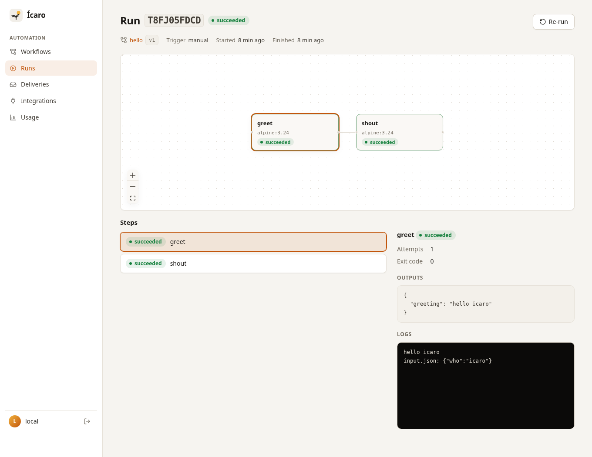
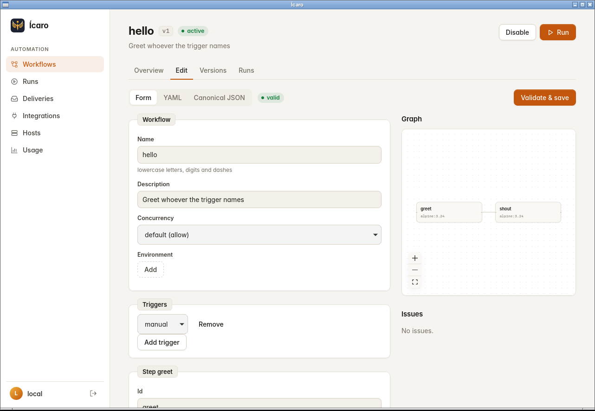

# Ícaro

**Run coding agents in parallel. Give every task its own workspace, preview, and shared context.**

Ícaro is an open-source tool for running coding agents and automating development workflows on your own machine. Work with Claude Code or Codex from your terminal, follow runs in the web UI, or keep an eye on them from the desktop app.

[](https://github.com/ggrocco/icaro/actions/workflows/ci.yml)
[](https://github.com/ggrocco/icaro/actions/workflows/docs.yml)
[](LICENSE)

[Get started](#get-started) · [UI tour](#see-ícaro-in-action) · [MCP and skills](#teach-your-agent-to-use-ícaro) · [Documentation](docs/README.md) · [Releases](https://github.com/ggrocco/icaro/releases)

## Why Ícaro?

When several agents work on the same project, they need room to work independently and a way to pass context along. Ícaro gives each task a git worktree on its own branch, an isolated container, and project memory shared across sessions.

| What you want to do | How Ícaro helps |
| --- | --- |
| Work on several tasks at once | Run agents in separate worktrees and containers, with a configurable concurrency cap. |
| Review a change while an agent works | Open a live preview at a predictable `<name>.localhost` URL when the project has a Compose stack. |
| Stop repeating context | Share decisions, findings, tasks, and handoffs through project-scoped memory over MCP. |
| Turn a repeated task into automation | Connect container steps, integration actions, approvals, and waits in a workflow. Run it manually, on a schedule, or from an event. |
| Follow what is happening | Inspect workflow graphs, step outputs, live logs, and estimated usage in the web UI. Get desktop notifications when runs fail. |
| Control what agents can access | Use profile-based network allowlists, a strict mount policy, and host-bound integration credentials. |

Built-in integrations connect workflows to **GitHub, GitLab, Slack, Jira, Linear, Sentry, and Datadog**. [Integration packs](docs/integrations.md) let you add more using YAML manifests.

## See Ícaro in action

### Web: follow a workflow from input to result



The run view shows each step's status and outputs, with logs streamed live. Build workflows with the form or YAML editor, inspect version history, and approve requests when a workflow needs a human decision. [Explore the web UI](docs/ui.md).

### App: build workflows and keep track of runs



Shown here is the Linux build. The desktop app opens the same UI in its own window and adds a menu with active runs, recent failures, previews, usage, and quick actions. It can launch at login and notify you about failed runs or daemon outages. [Desktop setup and platform status](docs/desktop.md).

These captures use local demo workflows. See the [screenshot notes](docs/images/README.md) for the capture environment and how to refresh them.

## Get started

You need **macOS or Linux**, **Git**, and a **running Docker engine** (Docker Desktop on macOS). On **Windows**, run Ícaro inside WSL2, or use `icaro.exe` as a client of a daemon running elsewhere ([Windows](docs/windows.md)). Agent sessions also need access to the provider you choose. The release installer requires OpenSSL 3.0+ to verify signatures.

### 1. Install and initialize

```sh
curl -fsSL https://github.com/ggrocco/icaro/releases/latest/download/install.sh | sh
icaro init
icaro setup
```

The installer verifies the release signature and checksum. Make sure `~/.local/bin` is on your `PATH` before running `icaro`. On macOS, you can install with `brew install ggrocco/tap/icaro` instead. [More installation options](docs/upgrading.md).

`icaro setup` prepares the profiles and container images, showing changes for review. The daemon starts automatically when a command needs it.

### 2. Start your first agent

```sh
icaro login claude       # once per profile
cd ~/src/my-app          # your existing git repository
icaro claude
```

Your agent works on a new branch in its own worktree. Profile logins are kept separately from your own `~/.claude`. For Codex, use `icaro login codex` and `icaro codex`.

In another terminal:

```sh
icaro session list      # see your sessions
icaro ui                # open the web UI with a one-time sign-in link
```

The [full quickstart](docs/quickstart.md) walks through a session, a first workflow, and the UI. To try workflows without an agent-provider login, run the [hello example](examples/hello.yaml) using the [workflow quickstart](docs/quickstart.md#5-run-a-workflow).

### 3. Choose your interface

| Interface | Start here |
| --- | --- |
| Terminal | `icaro --help` and the [CLI reference](docs/cli.md) |
| Browser | `icaro ui` and the [web UI guide](docs/ui.md) |
| macOS app | Download `Icaro_<version>_macos_universal.zip` from [Releases](https://github.com/ggrocco/icaro/releases), move the app to Applications, and follow the [desktop guide](docs/desktop.md). |

**Desktop status:** CI builds and tests the app on macOS and Linux; a clean-install test on a Mac is still pending. Releases attach it as `Icaro.app` for macOS and as a tarball for Linux (amd64 and arm64). See the desktop guide for signing and first-launch details.

## Teach your agent to use Ícaro

The **Model Context Protocol (MCP)** gives your agent tools to read workflow schemas, validate and run workflows, inspect results, and use project memory. The bundled **`icaro-workflows` skill** teaches it how to use those tools: discover the contract, validate a draft, run a small example, and debug the result.

Install the skill and MCP connection for the client you use:

```sh
icaro skill install                  # Claude Code
# Or:
icaro skill install --target codex   # Codex
```

Restart your agent client from your project repository so it loads the new configuration. Then try:

> Use the icaro-workflows skill to create a manual workflow named mcp-hello. Take a `who` input, greet that person in an Alpine container, and publish the greeting as an output. Fetch the schema first, validate the workflow, run it with who=icaro, and show me the result and logs.

Open `icaro ui` to see the workflow and its run. You can inspect the same result with `icaro runs list --workflow mcp-hello`.

The [MCP and skills tutorial](docs/agents.md#tutorial-your-first-workflow-with-an-agent) includes connection checks, the example YAML, tool calls, shared-memory prompts, manual client configuration, and troubleshooting. Agents inside Ícaro sessions already have their **memory MCP** connection configured; workflow authoring uses the host connection described above.

## How it fits together

One local daemon keeps the CLI, browser, desktop app, and MCP clients in sync.

```text
Terminal / Web UI / Desktop app / MCP client
                      |
                Ícaro daemon
                      |
          +-----------+-----------+
          |                       |
     Agent sessions           Workflows
     own worktree             container steps
     own container            integration actions
     live preview             approvals and waits
          |
     shared project memory
```

Workflows support parallel steps with dependencies, retries, timeouts, cancellation, and recovery after a daemon restart. Agent sessions use managed profile homes and network allowlists. Read the [security guide](docs/security.md) for the isolation model and its limits, including optional gVisor on Linux.

## Learn more

| Guide | What you will find |
| --- | --- |
| [Sessions](docs/sessions.md) and [previews](docs/previews.md) | Profiles, worktrees, provider logins, network policy, and per-session preview URLs |
| [Workflows](docs/workflows.md) and [examples](examples/) | Steps, inputs and outputs, schedules, approvals, and runnable YAML |
| [Integrations](docs/integrations.md) | Events, credentials, webhooks, deliveries, actions, and packs |
| [MCP and skills](docs/agents.md) and [shared memory](docs/memory.md) | Agent setup, workflow authoring, project context, and handoffs |
| [Installing and upgrading](docs/upgrading.md) | Signed releases, rollback, and startup services |
| [FAQ](docs/faq.md) | Common questions and troubleshooting |
| [Architecture and roadmap](blueprint/README.md) | Design decisions and [implementation status](blueprint/docs/04-roadmap.md#status) |

## Contribute and support the project

Try Ícaro on a project, [report a bug or suggest an improvement](https://github.com/ggrocco/icaro/issues), or contribute code and documentation. If it helps you, star the repository to help others discover it. Report vulnerabilities through [SECURITY.md](SECURITY.md).

For local development, you need **Go 1.26+**, **Docker**, and **Node 24**:

```sh
make web build          # build the UI and CLI
make test               # race-enabled Go tests
make test-integration   # Docker integration tests
make lint               # golangci-lint
```

See [CONTRIBUTING.md](CONTRIBUTING.md) for frontend tests, desktop builds, schema generation, and the full development workflow. Ícaro is licensed under the [MIT license](LICENSE).
